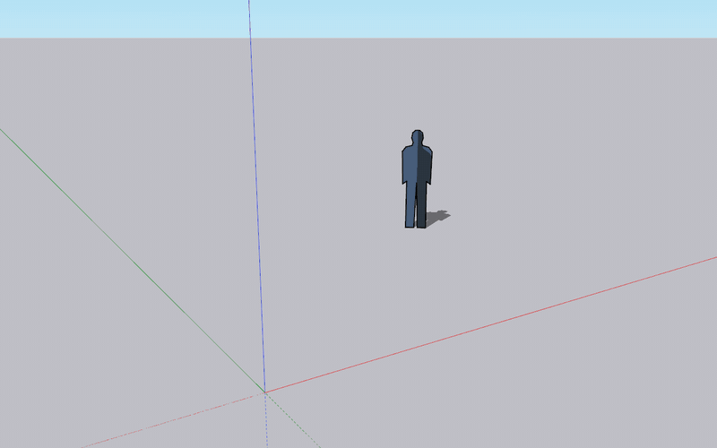
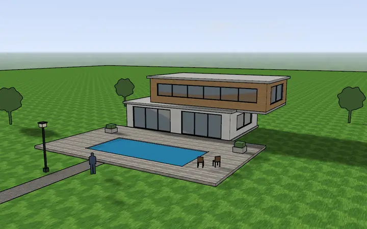
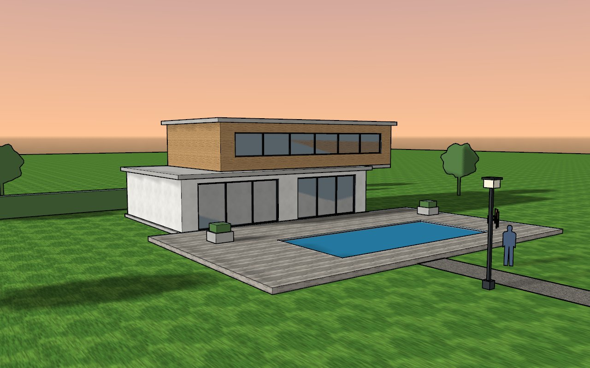
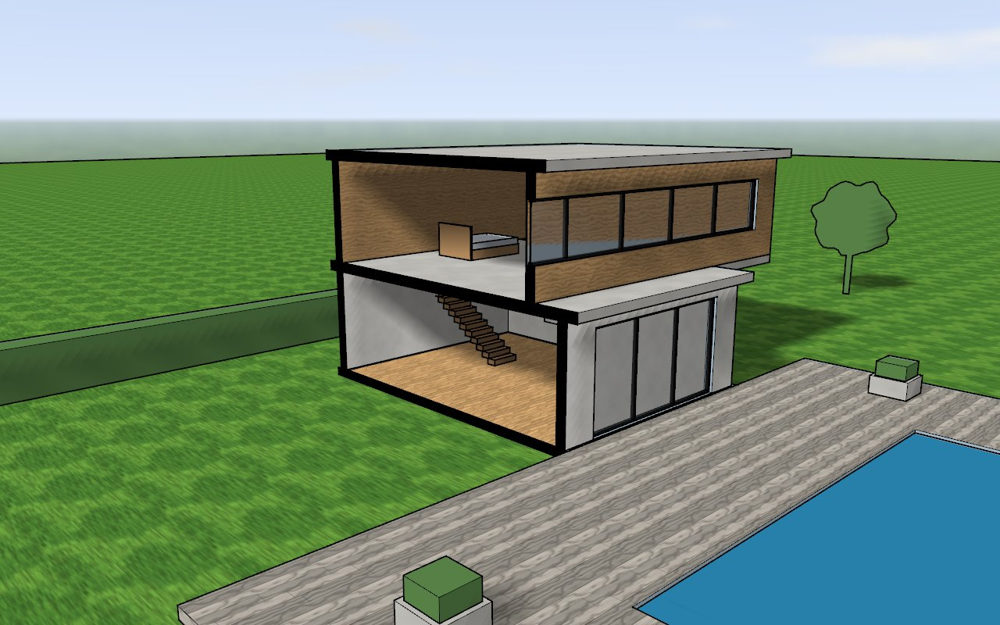
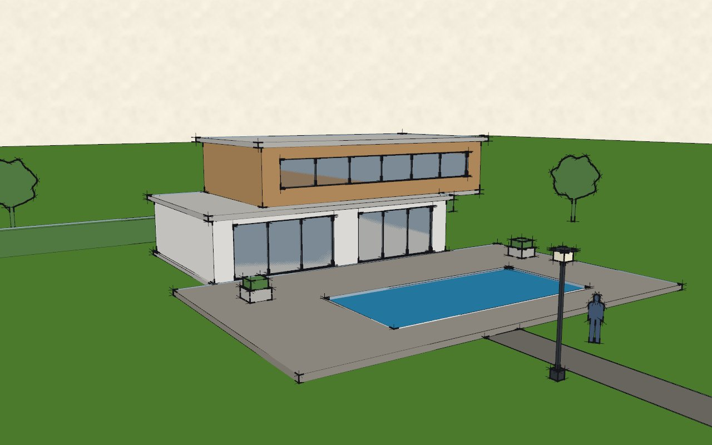
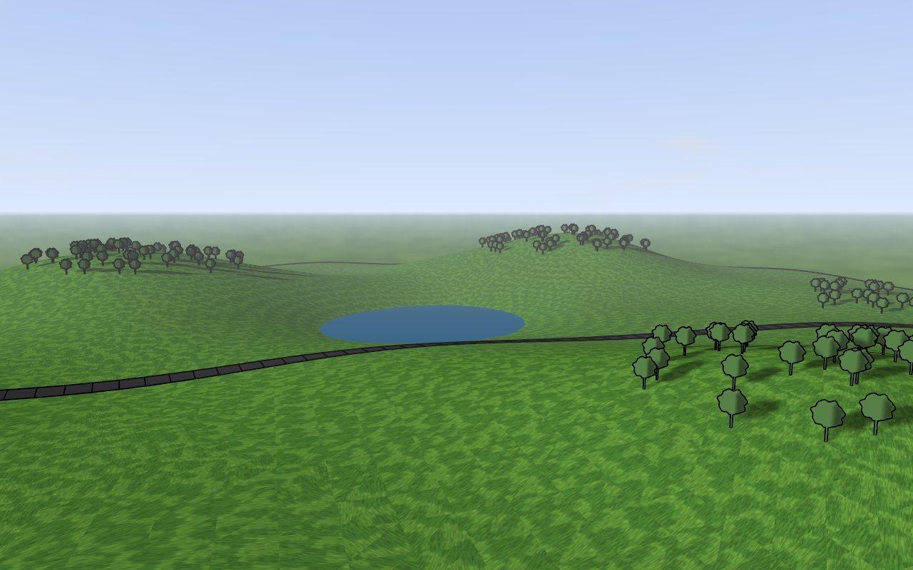
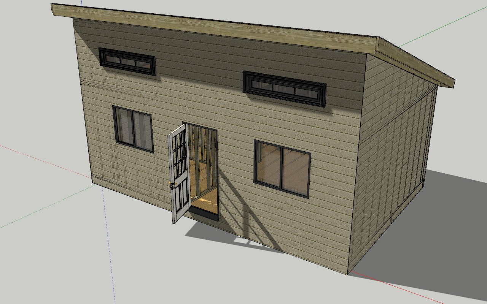
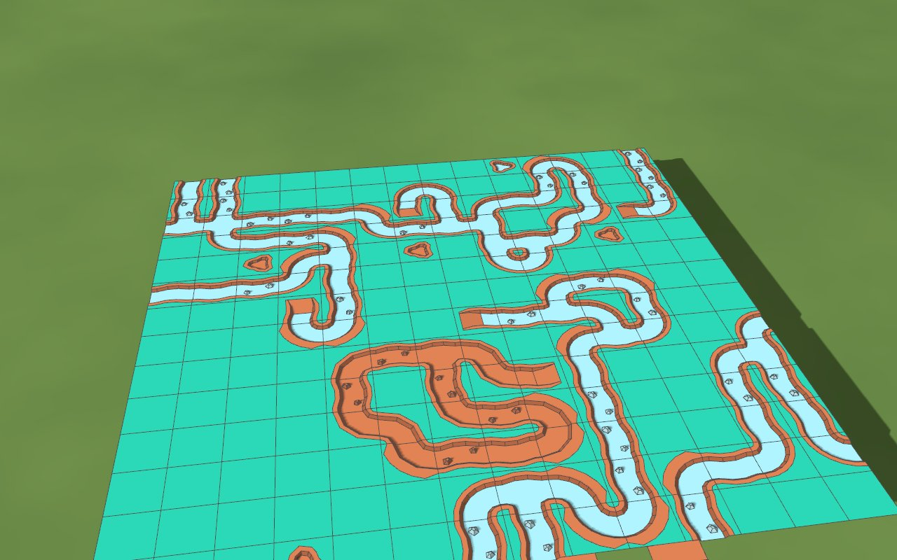

<p align="center">
  
</p>

<p align="center">
  
</p>

<p align="center">
  Modeleur 3D libre, écrit en Rust, qui ouvre et enregistre les fichiers de SketchUp.<br>
  <a href="README.en.md">English</a>
</p>


<table>
<tr>
<td width="50%"><br><sub>Tracer un rectangle, puis le pousser/tirer en volume.</sub></td>
<td width="50%"><br><sub>Orbite autour d'une maison, ombres de fin de journée.</sub></td>
</tr>
<tr>
<td><br><sub>Maison contemporaine au coucher du soleil : environnement HDR, ombres portées.</sub></td>
<td><br><sub>Coupe perspective : un plan de section ouvre la maison.</sub></td>
</tr>
<tr>
<td><br><sub>Le même modèle en style « Plume sur papier crème ».</sub></td>
<td><br><sub>Bac à sable : relief, lac, route drapée, brouillard.</sub></td>
</tr>
<tr>
<td><br><sub>Un vrai fichier <code>.skp</code> de SketchUp 8 ouvert dans Esquisse (crédit ci-dessous).</sub></td>
<td><br><sub>L'extension officielle Wave Function Collapse, chargée telle quelle.</sub></td>
</tr>
</table>

<sub>Tout est rendu par Esquisse. Modèles faits dans Esquisse avec le contenu livré, sauf : la petite maison, <a href="https://github.com/EddieOne/open-source-tiny-home">Open Source Tiny House V2</a> © 2014 One Fold Media, licence MIT ; l'extension <a href="https://github.com/SketchUp/wave-function-collapse">Wave Function Collapse</a> © 2022 Trimble Inc., licence MIT, et ses tuiles de <a href="https://www.kenney.nl/">Kenney</a> (CC0).</sub>

Esquisse se manie comme SketchUp : on trace des traits et des formes, les faces se créent
d'elles-mêmes, on les pousse et on les tire, les cotes se tapent au clavier. Il lit et écrit
les `.skp` de toutes les versions de SketchUp, de la 3 à la 2026, fait tourner les extensions
Ruby écrites pour SketchUp et fonctionne sans SketchUp ni aucun fichier de Trimble installé.
Il est publié sous licence MIT.

## En chiffres

- **Fichiers `.skp`** : sur 1 967 fichiers réels enregistrés par SketchUp 3 à 2026 et
  récupérés dans des dépôts publics, 1 966 sont lus exactement comme les lit le SDK de
  SketchUp, classe d'objets par classe d'objets.
- **Fonctions de l'application** : 332 sur 332 (commandes, outils, formats de fichier,
  panneaux, Infos sur le modèle, Préférences), hors services en ligne de Trimble.
- **API Ruby** : les 1 855 méthodes de l'API de SketchUp 2026 existent ; la suite officielle de
  tests de l'API (TestUp) en réussit 2 895 sur 3 020.
- **Tests** : 1 443 tests automatisés.

## Ce que l'on peut faire

### Dessiner et modeler

- Ligne, main levée, arcs (deux points, trois points, centre, portion de cercle), rectangle,
  rectangle orienté, cercle, polygone.
- Géométrie « collante » : un contour fermé et plan devient une face, une ligne tracée sur une
  face la coupe, un rectangle dans une face y fait un trou.
- Pousser/Tirer, Suivez-moi, Décalage, Déplacer et copier (copies en série), Faire pivoter,
  Échelle, Retourner, Effacer (masquer, adoucir).
- Inférences sur les extrémités, les milieux, les arêtes, les faces et les axes ; les flèches
  verrouillent une direction, Maj verrouille l'inférence en cours.
- Boîte de mesures : longueurs, angles, nombre de segments et copies en série se tapent au
  clavier, dans l'unité du modèle.
- Mètre et Rapporteur (guides), Intersection des faces, Adoucir les arêtes, Souder les arêtes.
- Outils de solides : Union, Soustraire, Intersection, Découper, Diviser, Enveloppe externe.
- Bac à sable : terrain à partir des contours ou de zéro, Modeler, Tamponner, Draper, Ajouter
  des détails, Retourner l'arête.
- Texte 3D, Cotations, Texte à repère ; les cotes et les textes attachés suivent ce à quoi ils
  sont attachés.
- Plans de section, avec remplissage de la coupe.

### Organiser

- Groupes et composants : définitions partagées, rendre unique, éclater, collage sur une face,
  découpe de l'ouverture, face toujours tournée vers la caméra.
- Panneaux Structure, Étiquettes (dossiers, couleurs, tirets), Infos sur l'entité.
- Classificateur et classements IFC.

### Matières, styles et présentation

- Matières : couleur, texture, opacité, colorisation, réglages PBR ; positionner, projeter et
  rendre unique une texture.
- Styles : arêtes (esquissées, par axe, par matière, profils, extrémités), faces, arrière-plan,
  ciel et sol, filigranes, réglages de modélisation ; mélange de styles.
- Ombres (soleil, date, heure, géolocalisation), brouillard, environnements (panoramas HDR en
  fond et pour les reflets), occlusion ambiante, incrustations, grille du modèle.
- Caméras : orbite, panoramique, zoom, champ angulaire, perspective, projection parallèle,
  perspective à deux points, positionner la caméra, visite, Adapter une photo.
- Scènes, transitions et animation.

### Fichiers

- `.skp` : ouverture et enregistrement natifs pour SketchUp 3 à 2026, enregistrement dans une
  version antérieure, aller-retour sans perte (textures, styles, scènes, attributs, cotes).
- Importer : 3DS, COLLADA, MNT (DEM), DWG et DXF, glTF et GLB, IFC, KMZ, STL, TRB, USD et
  USDZ ; images BMP, JPEG, PNG, PSD, TGA, TIFF et PDF, comme image, texture ou photo adaptée.
- Exporter en 3D : 3DS, COLLADA, DWG et DXF, FBX, IFC, KMZ, OBJ, STL, VRML, XSI, glTF et GLB,
  USDZ.
- Exporter en 2D : PNG, JPEG, BMP, TIFF, PDF vectoriel, EPS, DWG et DXF (lignes cachées),
  tranche de section ; animation en MP4, WebM, AVI ou suite d'images ; impression.
- Format natif `.esq`, en JSON.

### Contenu livré

300 matières, 111 styles, 18 environnements, 21 modèles types, 12 composants, 12 motifs de
hachures et 2 classements IFC, tous fabriqués par Esquisse et sous licence MIT.

### Extensions Ruby

- Ruby 3.2 embarqué (la même version que SketchUp 2026) et toute l'API de SketchUp : géométrie,
  entités, outils, observateurs, `UI::HtmlDialog`, menus et barres d'outils.
- Console Ruby, gestionnaire d'extensions, dossier `Plugins`, installation des `.rbz`.

### Réglages

Préférences (raccourcis, modèle type par défaut, sauvegarde automatique…), Infos sur le
modèle (unités, géolocalisation, statistiques…), palettes de panneaux, barres d'outils,
recherche de commandes.

## Ce qui manque

- Les services en ligne de Trimble (3D Warehouse, Extension Warehouse, Trimble Connect,
  assistant et rendu par IA, avant-projet, licences, mises à jour) : hors périmètre.
- LayOut et Style Builder, qui sont des applications à part.
- L'interface est en français seulement, et Esquisse ne tourne que sous Windows 10 et 11
  (64 bits).
- Les extensions chiffrées (`.rbe`, `.rbs`) ne se chargent pas, et deux entrées de menu restent
  grisées : l'outil Interagir des composants dynamiques et l'épingle de localisation.
- 125 tests de TestUp ne passent pas encore (dont 65 que la suite saute d'elle-même et 20 qui
  demandent des fichiers livrés avec SketchUp), et 1 fichier `.skp` réel sur 1 967 diffère encore
  du SDK.
- L'export vidéo demande ffmpeg, qui n'est pas fourni.
- Il n'y a pas encore de version publiée : Esquisse se compile depuis les sources.

## Compiler et lancer

Prérequis : Windows 10 ou 11 (64 bits), [Rust](https://rustup.rs) stable avec la chaîne MSVC
(Visual Studio Build Tools, C++), et pour l'API Ruby le
[RubyInstaller](https://rubyinstaller.org) 3.2 x64 (archive `.7z`, sans installation).

```powershell
git clone https://github.com/ponthieutheo/esquisse
cd esquisse
cargo build --release
powershell -File tools\ruby-dev.ps1 -Ruby C:\chemin\vers\rubyinstaller-3.2.11-1-x64 -Release
target\release\esquisse.exe
```

Sans Ruby, Esquisse fonctionne mais sans extensions. Un dossier autonome, prêt à copier sur
un autre PC, se fabrique avec `powershell -File tools\package.ps1 -Ruby <dossier de
RubyInstaller>` (résultat dans `target\paquet\Esquisse`).

Tests : `cargo test --workspace`. Les tests Ruby sont sautés sans runtime Ruby ; avec
`ESQ_REQUIRE_RUBY=1`, son absence les fait échouer.

## Documentation

Guide illustré :

1. [Prise en main](docs/guide/prise-en-main.md)
2. [Dessiner et modeler](docs/guide/dessiner.md)
3. [Organiser le modèle](docs/guide/organiser.md)
4. [Matières, styles et environnements](docs/guide/apparence.md)
5. [Ombres, scènes et coupes](docs/guide/presenter.md)
6. [Cotes et textes](docs/guide/annoter.md)
7. [Fichiers : `.skp`, import et export](docs/guide/fichiers.md)
8. [Ruby et extensions](docs/guide/ruby.md)
9. [Réglages](docs/guide/reglages.md)

Pour aller plus loin : le [format `.skp`](docs/skp-format.md), les
[règles de sécurité](docs/securite.md) appliquées aux fichiers et aux extensions,
le [fonctionnement sans SketchUp](docs/autonomie.md), la
[couverture de l'API Ruby](docs/ruby-coverage.md) et la
[parité avec SketchUp](docs/sketchup-parity.md).

## Licence

Esquisse est sous licence MIT ([`LICENSE-MIT`](LICENSE-MIT)). Les composants tiers et leurs
licences sont listés dans [`THIRD-PARTY.md`](THIRD-PARTY.md).

## Marques

Esquisse est un projet indépendant. Il n'est ni affilié à Trimble Inc., ni approuvé ou soutenu
par Trimble. SketchUp est une marque de Trimble Inc. ; ce nom n'est employé ici que pour
indiquer avec quels fichiers et quelles extensions Esquisse est compatible.
