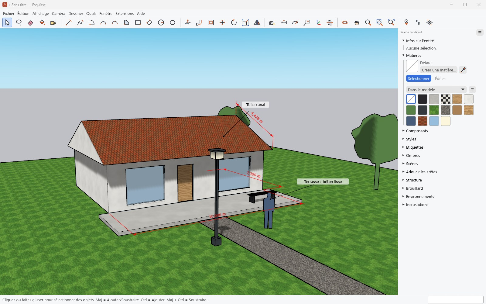

# Cotes et textes

[Guide](../../README.md#documentation) · [English](en/annotating.md)

- L'outil **Cotations** cote une longueur entre deux points ou le long d'une arête ; la valeur
  suit l'unité et la précision du modèle. Les cotes radiales des fichiers de SketchUp sont lues
  et écrites.
- L'outil **Texte** pose un texte à repère : sur une face, il affiche son aire par défaut ; sur
  une arête, sa longueur ; sur un composant, son nom. Sans repère, il reste fixé à l'écran.
- **Texte 3D** crée un texte en volume (ou en contours), dans une police du système.
- Les cotes et les textes attachés suivent ce à quoi ils sont attachés : on déplace, tourne ou
  met à l'échelle le mur, la cote suit. Ces attaches sont lues et écrites dans le `.skp`.
- **Fenêtre › Infos sur le modèle › Cotations** et **Texte** règlent la police, les flèches et
  l'alignement ; **Infos sur l'entité** modifie une cote ou un texte sélectionné.
- **Outils › Mètre** mesure une distance et pose des guides ; **Rapporteur** pose des guides
  d'angle. **Édition › Supprimer les guides** les retire.
