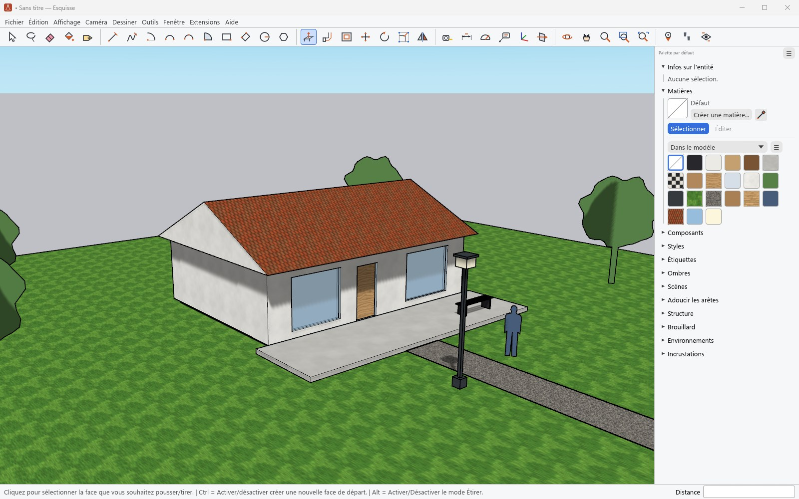
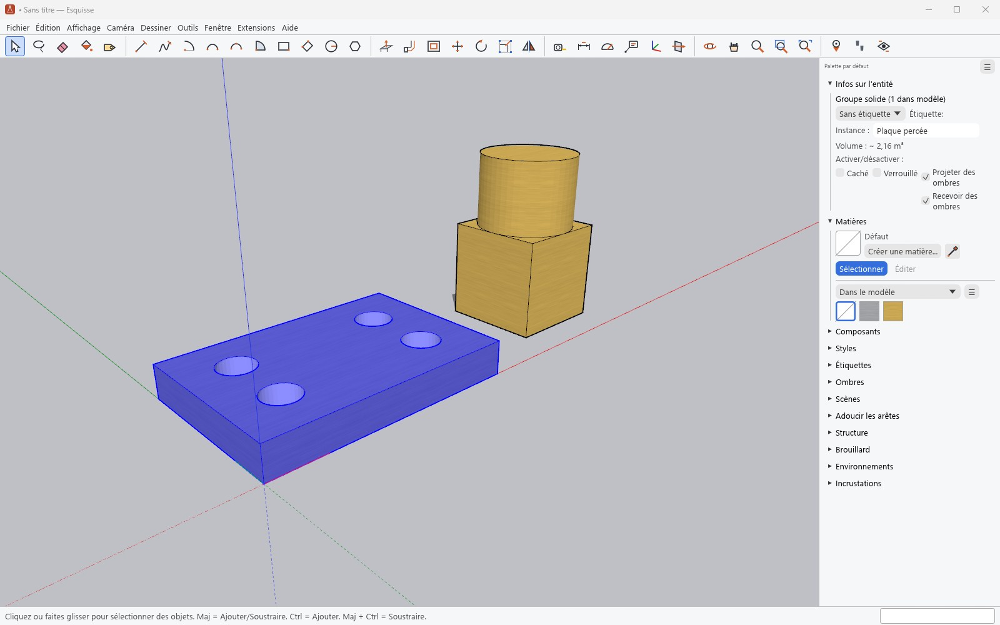
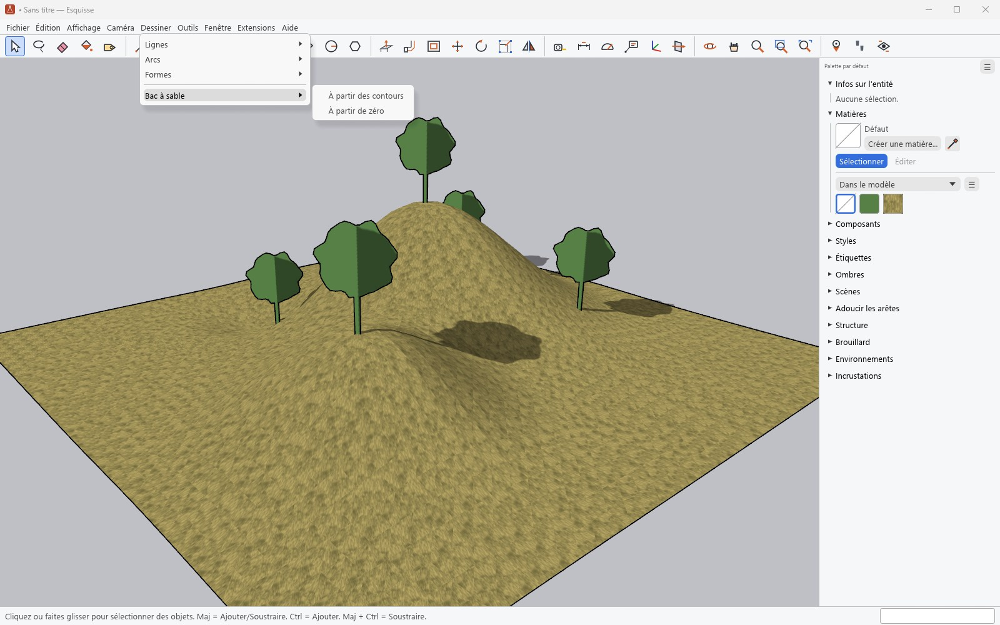

# Dessiner et modeler

[Guide](../../README.md#documentation) · [English](en/drawing.md)

## Outils, barre d'état et boîte de mesures

Chaque outil dit dans la barre d'état ce qu'il attend et ce que font ses touches de
modification (Ctrl, Alt, Maj, flèches). La boîte de mesures, en bas à droite, reçoit ce qui se
tape au clavier pendant ou juste après une opération, sans cliquer dedans :

| Saisie | Effet |
|---|---|
| `2,5` ou `2,5m`, `80cm`, `6'4"` | une longueur, dans l'unité du modèle ou celle tapée |
| `4;3` | les deux côtés d'un rectangle |
| `24s` | le nombre de segments d'un cercle, d'un arc ou d'un polygone |
| `45` | un angle, avec Faire pivoter ou le Rapporteur |
| `5x` ou `/5` après une copie | une série de copies, ou des copies réparties |

**Dessin** : Ligne, Main levée, Arc (centre, deux points, trois points, portion de cercle),
Rectangle, Rectangle orienté, Cercle, Polygone. Un contour fermé et plan devient une face ; une
ligne qui traverse une face la coupe ; une forme tracée dans une face y fait un trou.

**Modification** : Pousser/Tirer (Ctrl garde la face de départ, un double-clic répète la
dernière distance), Suivez-moi, Décalage, Déplacer (Ctrl copie), Faire pivoter, Échelle,
Retourner, Effacer (Maj masque, Ctrl adoucit).

**Inférences** : extrémités, milieux, points sur une arête ou une face, axes rouge, vert et
bleu. Les flèches verrouillent un axe ; Maj verrouille l'inférence en cours.

**Construction** : Mètre et Rapporteur (guides), Axes, Cotations, Texte, Texte 3D.

## Outils de solides

Un groupe ou un composant fermé est un solide : Infos sur l'entité affiche son volume. Les
outils de **Outils › Solides** combinent deux solides : Intersection, Union, Soustraire,
Découper et Diviser ; **Outils › Enveloppe externe** n'en garde que la peau. Le résultat reste un
solide.

## Bac à sable : terrains

- **Dessiner › Bac à sable › À partir des contours** fait un terrain à partir de courbes de
  niveau sélectionnées.
- **À partir de zéro** trace une grille plane à déformer.
- Les outils de **Outils › Bac à sable**, **Modeler**, **Tamponner**, **Draper**, **Ajouter des
  détails** et **Retourner l'arête**, déforment le terrain, y posent l'empreinte d'un objet ou y
  projettent des arêtes.

## Et aussi

- **Édition** : couper, copier, coller, coller sur place, masquer et verrouiller, créer un
  groupe ou un composant, Intersection des faces (avec le modèle, la sélection ou le
  contexte), Souder les arêtes.
- **Clic droit** : le menu contextuel propose, selon ce qui est sélectionné, les entrées de
  SketchUp (inverser ou orienter les faces, diviser une arête, intersection, éclater, rendre
  unique…) ; le panneau **Adoucir les arêtes** lisse un maillage.
- Annuler et rétablir s'appliquent à tout.
