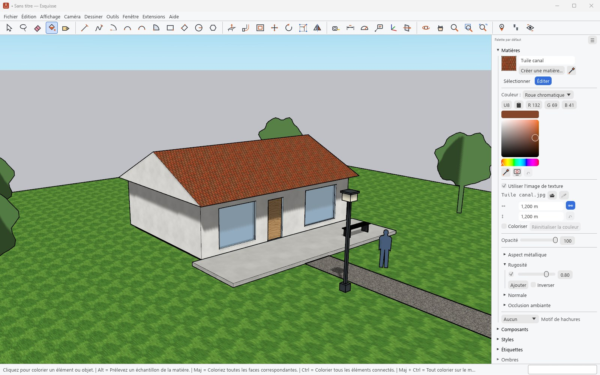
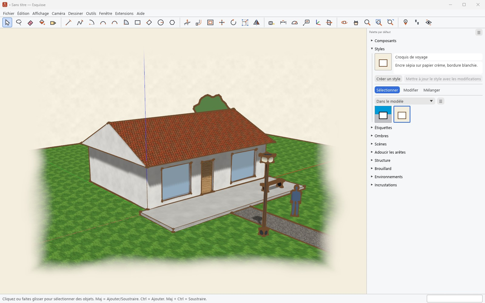
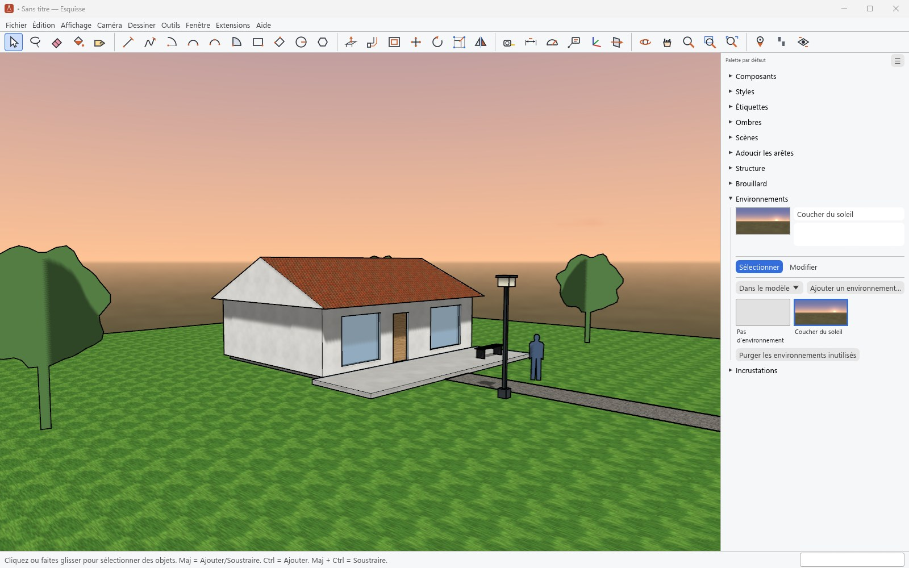

# Materials, styles and environments

[Guide](../../../README.en.md#documentation) · [Français](../apparence.md)

## Materials

- The **Paint Bucket** applies the current material: Shift paints all faces with the same
  material, Ctrl everything connected, Alt samples a material from the model.
- The **Materials** panel browses the model's materials and the bundled collections (300
  materials: bricks, wood, metals, stone, ground, roofing, glass, solid colours…).
- The **Edit** tab sets the colour, the texture (image and size), colorize, opacity, PBR maps
  (metalness, roughness, normal, ambient occlusion) and the section hatch pattern.
- Right-click on a textured face, **Texture** submenu: position the texture, project it, reset
  its position or edit its image.

## Styles

- A style gathers the look of edges (sketchy, profiles, endpoints, extensions, by axis or by
  material), faces (shaded, textured, monochrome, X-ray, wireframe, hidden line), background
  (sky, ground), watermarks and modelling settings.
- 111 styles are bundled in eight collections: sketchy edges, straight lines, colour sets,
  ambient occlusion, default styles, photo modelling, assorted styles and competition winners.
- **Edit** changes the current style; **Mix** combines settings from several styles; each scene
  can keep its own style.

## Environments

An environment is an HDR panorama: it serves as the background (sky dome) and as the source of
reflections for PBR materials. Esquisse bundles 18 (skies, studio, desert, city, snowy
mountain…); **Add Environment** takes an `.hdr`, an `.exr` or a SketchUp `.ske`. The **Edit**
tab sets rotation, exposure and the link with the sun.

## Also

- **Fog**: distance and colour, or the background colour.
- **Affichage › Style de faces** and **Style d'arêtes** (View › Face Style, Edge Style) switch
  between display modes in one click; ambient occlusion darkens recesses.
- **Overlays** and the **Model Grid** draw over the view.
