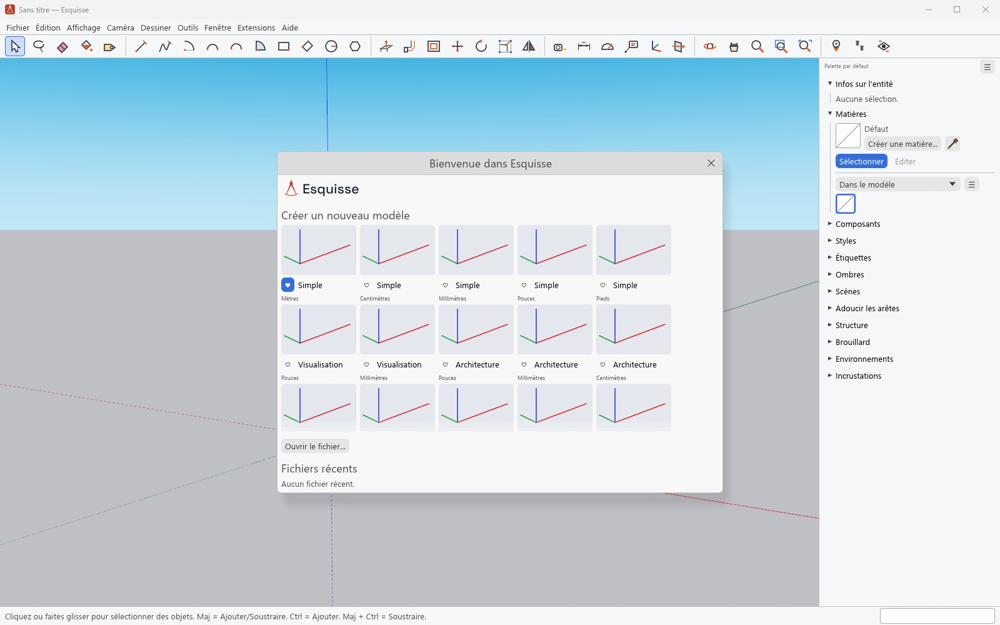
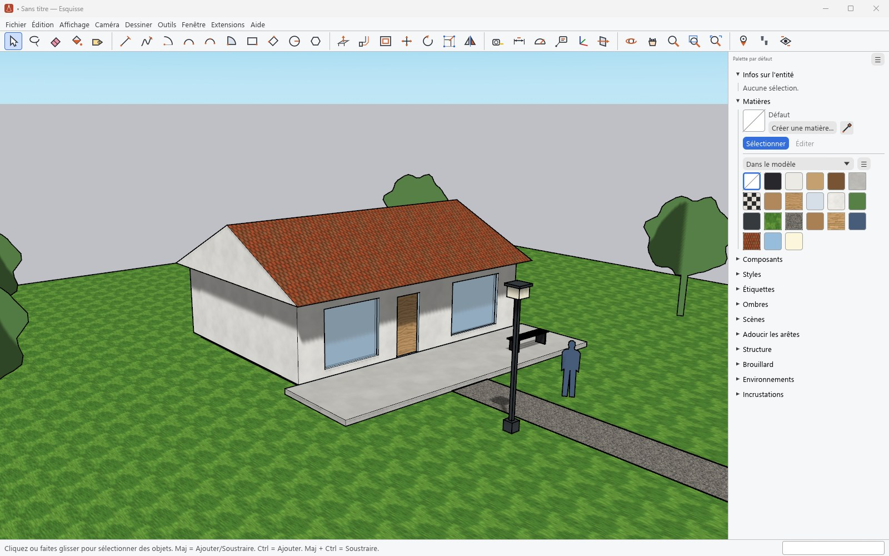

# Getting started

[Guide](../../../README.en.md#documentation) · [Français](../prise-en-main.md)

The interface is in French for now; menu names are given in French with their English meaning.

## Welcome window

On start-up, the welcome window (*Bienvenue*) offers to create a model from a template
(Simple, Visualisation, Architecture, Plan view, Urban planning, Landscape, Woodworking,
Interiors, 3D printing, each in metric or imperial units), to open a file or to reopen a recent
one. The heart marks the template used by **Fichier › Nouveau** (File › New). The window can be
turned off in **Fenêtre › Préférences › Général** (Window › Preferences › General).

## The interface

- **Menus**: Fichier, Édition, Affichage, Caméra, Dessiner, Outils, Fenêtre, Extensions, Aide
  (File, Edit, View, Camera, Draw, Tools, Window, Extensions, Help), with the same commands and
  shortcuts as SketchUp.
- **Toolbar**: selection, drawing, editing, construction and camera tools. More toolbars are
  shown from **Affichage › Barres d'outils** (View › Toolbars).
- **Panel tray**, on the right: Entity Info, Materials, Components, Styles, Tags, Shadows,
  Scenes, Soften Edges, Outliner, Fog, Environments, Overlays. **Fenêtre › Gérer les
  palettes** (Window › Manage Trays) creates more.
- **Status bar**, at the bottom: what the active tool expects and its modifier keys; on the
  right, the Measurements box.

## Navigating

| Action | Mouse or keyboard |
|---|---|
| Orbit | middle button, or `O` |
| Pan | Shift + middle button, or `H` |
| Zoom | wheel, or `Z` |
| Zoom Extents | `Shift+Z` |
| Standard views | **Caméra › Vues standard** (Camera › Standard Views) |

The wheel zooms towards the point under the cursor. **Caméra** also offers perspective,
parallel projection and two-point perspective.

## Opening and saving

**Fichier › Ouvrir** (File › Open) reads `.skp` files from every SketchUp version and
Esquisse's native `.esq` format. **Enregistrer** (Save) writes the `.skp` in the current
version (2026); **Enregistrer sous** (Save As) also offers older versions. See
[Files](files.md).
