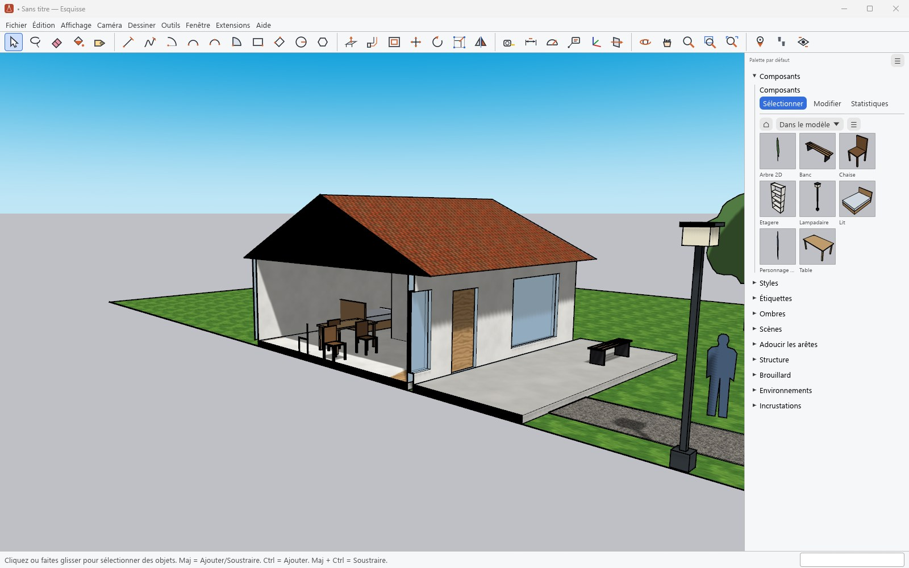
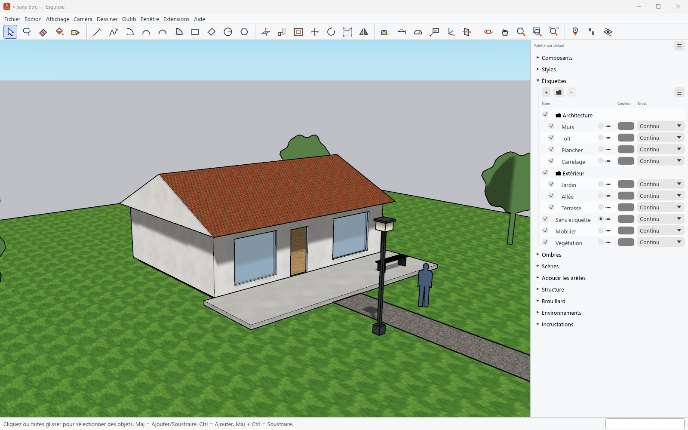
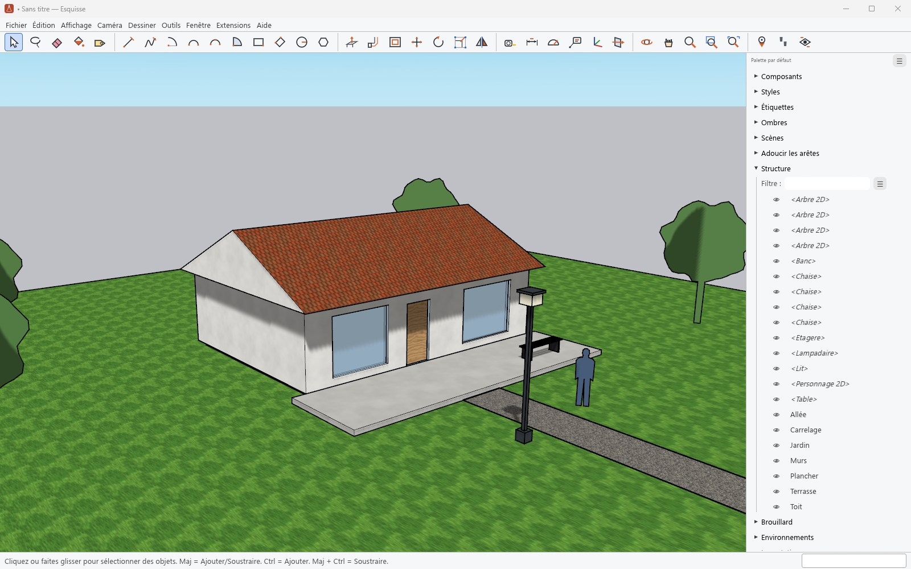

# Organising the model

[Guide](../../../README.en.md#documentation) · [Français](../organiser.md)

## Groups and components

- **Make Group** isolates faces and edges; **Make Component** turns them into a shared
  definition: editing one copy edits all the others, except a copy made unique.
- A double-click opens a group or component for editing; Escape closes it. The rest of the
  model can be faded or hidden while editing.
- A component can glue to a face, cut its opening in a wall (doors, windows) or always face the
  camera (2D people and trees).
- The **Components** panel browses the model's components and the bundled ones, places them,
  edits their settings and shows their statistics. A `.skp` or `.esq` file is inserted as a
  component with **Fichier › Importer** (File › Import).
- **Entity Info** shows and edits the selection: name, tag, material, volume of a solid, cast and
  received shadows, and the settings of each entity type.

## Tags

Tags (formerly layers) control the visibility of what they are given to. The panel arranges them
in folders, gives them a colour and a dash pattern, and can colour the model by tag
(**Affichage › Colorer par étiquette**, View › Color by Tag). The Tag tool assigns a tag with a
click.

## Outliner

The **Outliner** (*Structure*) panel shows the tree of groups and components; a filter finds an
item by name, and the eye hides or shows it.

## Classifying

The **Classifier** tool gives an IFC type (wall, slab, window…) to a group or component, from
the bundled IFC 2x3 and IFC 4 classifications (**Fenêtre › Infos sur le modèle ›
Classements**, Window › Model Info › Classifications). These types are kept in the `.skp`.
