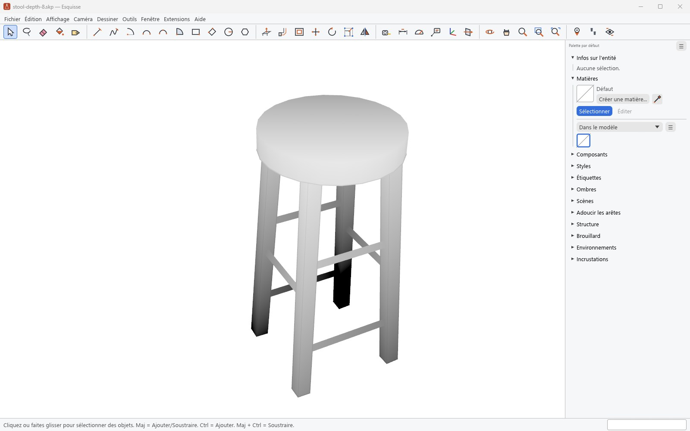
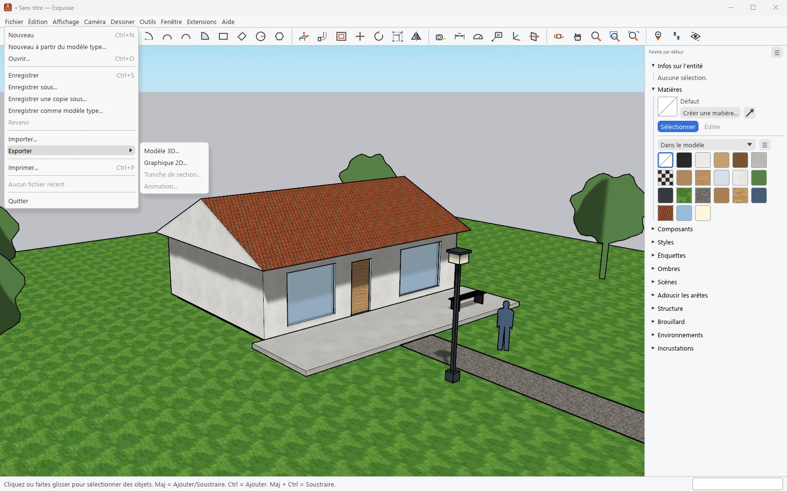

# Fichiers : `.skp`, import et export

[Guide](../../README.md#documentation) · [English](en/files.md)

## Le format `.skp`

*Modèle : `stool-depth.skp` du dépôt DeqianBai/Python-Project, licence Apache-2.0
(`crates/esq-skp/tests/reel`).*

- Esquisse lit et écrit les `.skp` lui-même, sans SketchUp ni son SDK : les fichiers de
  SketchUp 3 à 2020 (archives MFC) comme ceux de 2021 à 2026 (archives ZIP).
- Sur un corpus de 1 967 fichiers réels enregistrés par SketchUp 3 à 2026, 1 966 sont lus
  exactement comme les lit le SDK de SketchUp, classe d'objets par classe d'objets.
- **Enregistrer** écrit la version actuelle (2026) ; **Enregistrer sous** propose les versions
  antérieures, comme SketchUp. Un modèle ouvert puis enregistré garde ce que SketchUp y avait
  mis : textures, styles, scènes, attributs, cotes, ancrages, espaces, classements.
- Les fichiers abîmés sont refusés proprement ou réparés à l'ouverture
  (**Fenêtre › Infos sur le modèle › Statistiques › Corriger**).
- `.esq` est le format natif d'Esquisse : du JSON lisible.

## Importer et exporter

| | Formats |
|---|---|
| Importer en 3D | 3DS, COLLADA (`.dae`), MNT (`.dem`, `.ddf`), AutoCAD (`.dwg`, `.dxf`), glTF (`.glb`, `.gltf`), IFC (`.ifc`, `.ifczip`), Google Earth (`.kmz`), STL, Trimble (`.trb`), USD (`.usd`, `.usdz`) |
| Importer une image | BMP, JPEG, PNG, PSD, TGA, TIFF, PDF ; comme image, comme texture d'une face ou comme photo adaptée |
| Exporter en 3D | 3DS, COLLADA, DWG et DXF, FBX, IFC, KMZ, OBJ (avec `.mtl` et textures), STL, VRML, XSI, glTF et GLB, USDZ |
| Exporter en 2D | PNG, JPEG, BMP, TIFF, PDF vectoriel, EPS, DWG et DXF en lignes cachées |
| Exporter une coupe | tranche de section en DWG, DXF ou SVG |
| Exporter une animation | MP4, WebM, AVI (ffmpeg requis) ou suite d'images |

Chaque format a ses options, les mêmes que dans SketchUp (bouton **Options...** de la boîte
d'export ou d'import). DWG et DXF s'écrivent dans la version choisie, de R12 à 2018.
**Fichier › Imprimer** imprime la vue à l'échelle ou en mosaïque.

## Modèles types

**Fichier › Nouveau à partir du modèle type** et la fenêtre d'accueil proposent les 21 modèles
types livrés, plus ceux de l'utilisateur : **Fichier › Enregistrer comme modèle type** en ajoute
un. Le modèle type par défaut se choisit dans **Fenêtre › Préférences › Modèle type**.
