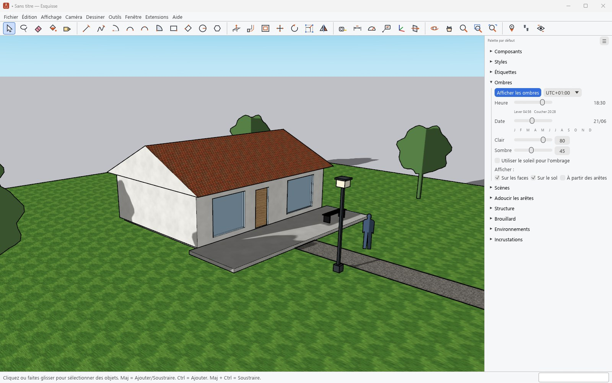
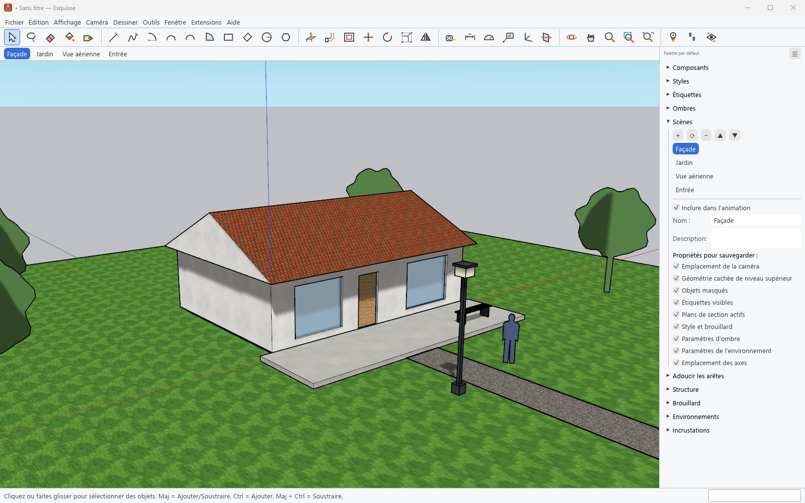
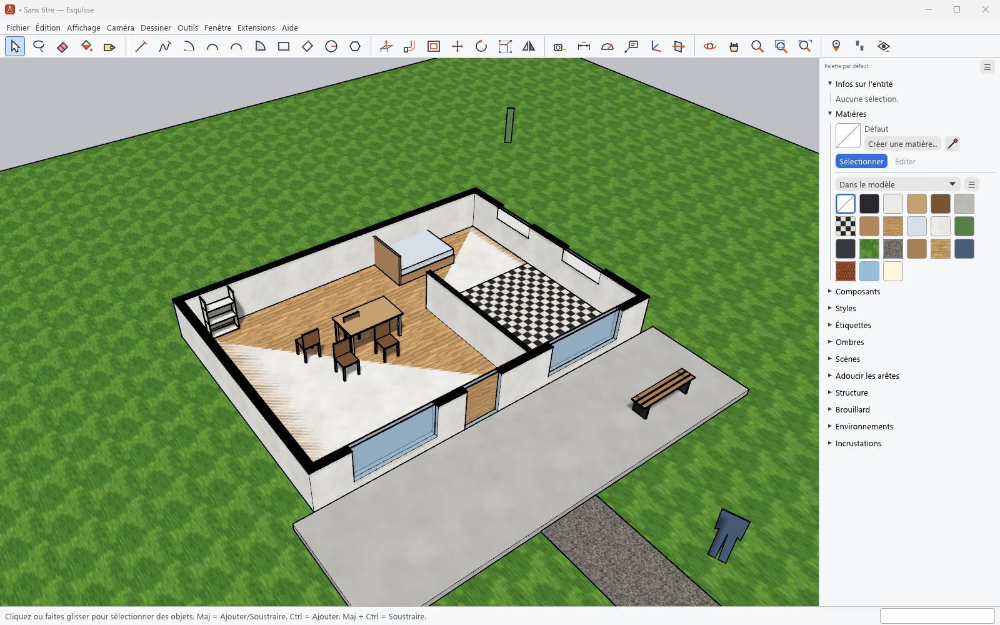

# Ombres, scènes et coupes

[Guide](../../README.md#documentation) · [English](en/presenting.md)

## Ombres

Le panneau **Ombres** règle l'heure, la date et le fuseau horaire ; le lever et le coucher du
soleil s'affichent sous le curseur de l'heure. La position du soleil suit la géolocalisation du
modèle (**Fenêtre › Infos sur le modèle › Géolocalisation**). Les ombres se portent sur les
faces, sur le sol, ou partent des arêtes ; les curseurs Clair et Sombre règlent l'éclairage.

## Scènes

Une scène garde un point de vue et, au choix, les étiquettes visibles, les objets masqués, les
plans de section actifs, le style, le brouillard, les ombres, l'environnement et les axes. Les
onglets passent d'une scène à l'autre avec une transition ; **Affichage › Animation** les
enchaîne, et **Fichier › Exporter › Animation** en fait une vidéo (ffmpeg requis) ou une suite
d'images.

## Plans de section

L'outil **Plan de section** coupe le modèle ; la coupe se remplit (couleur réglée par le style)
et s'exporte en DWG, DXF ou SVG (**Fichier › Exporter › Tranche de section**). Chaque groupe ou
composant peut avoir son propre plan actif, et une scène retient les plans actifs.

## Caméras

**Caméra** propose les vues standard, la perspective, la projection parallèle et la perspective
à deux points, le champ angulaire, **Positionner la caméra**, **Visite** et **Pivoter** pour se
promener dans le modèle, et **Adapter une photo** pour modéliser par-dessus une photographie.
