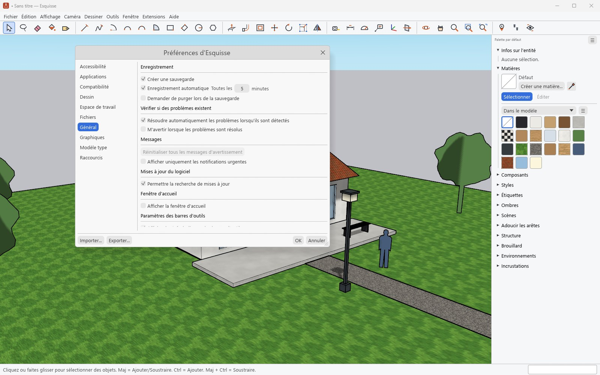
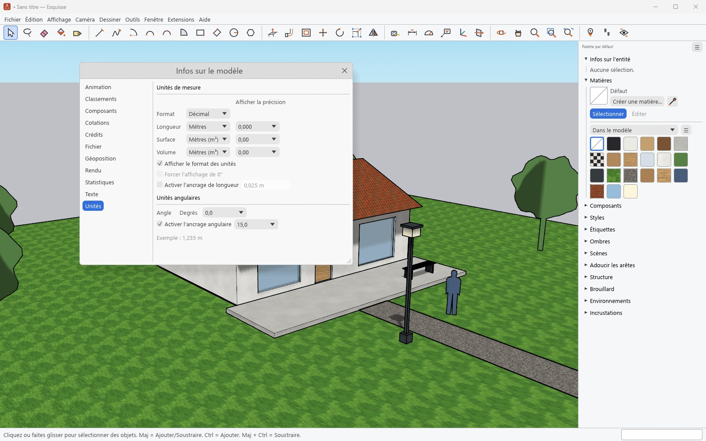

# Réglages

[Guide](../../README.md#documentation) · [English](en/settings.md)

## Préférences

**Fenêtre › Préférences** règle l'application : accessibilité (couleurs des axes et des
inférences), applications (éditeur d'images), compatibilité (sélection, molette), dessin
(clic-glisser, réticules), espace de travail, emplacements des fichiers, général (copie de
sauvegarde, enregistrement automatique, vérification des modèles), graphiques
(anticrénelage), modèle type par défaut et raccourcis clavier. Les raccourcis s'affectent,
s'importent, s'exportent et se réinitialisent ; les préférences s'exportent et s'importent.

## Infos sur le modèle

**Fenêtre › Infos sur le modèle** règle le modèle ouvert : animation, classements, composants
(estomper le reste du modèle pendant l'édition), crédits, cotations, fichier, géolocalisation,
rendu, statistiques (purger, corriger), texte et unités (format, précision, accrochage des
longueurs et des angles). Ces réglages sont enregistrés dans le `.skp`.

## Espace de travail

- **Fenêtre › Gérer les palettes** crée, renomme et range les palettes de panneaux.
- **Affichage › Barres d'outils** affiche ou personnalise les barres d'outils.
- **Aide › Rechercher dans Esquisse** (Maj+S) retrouve une commande par son nom et la lance.
- Les préférences, les palettes et les extensions de l'utilisateur sont dans
  `%APPDATA%\Esquisse`.
