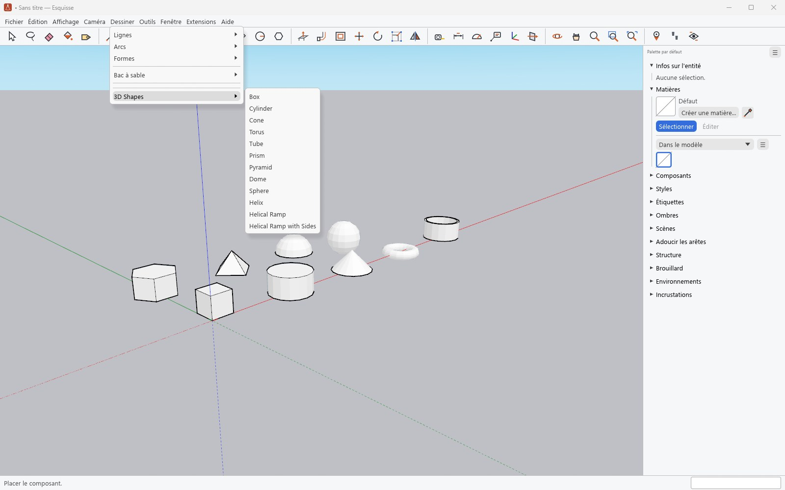
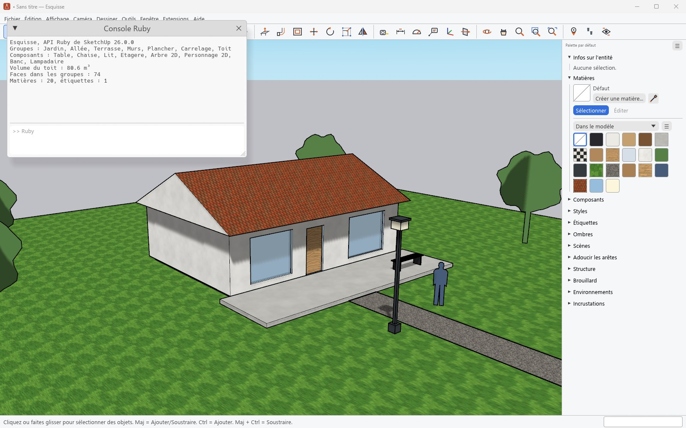

# Ruby et extensions

[Guide](../../README.md#documentation) · [English](en/ruby.md)

## Les extensions de SketchUp



*Extension : [sketchup-shapes](https://github.com/SketchUp/sketchup-shapes), © Trimble
Navigation Ltd., licence MIT, sans modification.*

- Esquisse embarque Ruby 3.2, la version de SketchUp 2026, et toute l'API Ruby de SketchUp :
  les 1 855 méthodes de ses classes (`Sketchup`, `Geom`, `UI`, entités, outils, observateurs,
  `UI::HtmlDialog`…) existent ; la liste est dans [la couverture de l'API](../ruby-coverage.md).
- Les extensions se posent dans le dossier `Plugins` d'Esquisse
  (`%APPDATA%\Esquisse\Plugins`) ou s'installent depuis un `.rbz`
  (**Extensions › Gestionnaire d'extensions**), puis ajoutent leurs menus, barres d'outils et
  outils comme dans SketchUp.
- La suite officielle de tests de l'API Ruby de SketchUp (TestUp) réussit 2 895 tests sur
  3 020 ; des extensions d'exemple de SketchUp publiées sur GitHub (formes 3D, Weld, Draw Mesh)
  tournent sans modification.
- Les extensions chiffrées (`.rbe`, `.rbs`), fréquentes dans le commerce, ne se chargent pas.

## Console Ruby



**Extensions › Développeur › Console Ruby** exécute du Ruby sur le modèle ouvert : Entrée lance
la ligne, Maj+Entrée passe à la ligne, les flèches rappellent l'historique. Les `puts` des
scripts et des extensions s'y affichent.

```ruby
model = Sketchup.active_model
face = model.active_entities.add_face([0, 0, 0], [2.m, 0, 0], [2.m, 1.m, 0], [0, 1.m, 0])
face.pushpull(-2.5.m)
```
